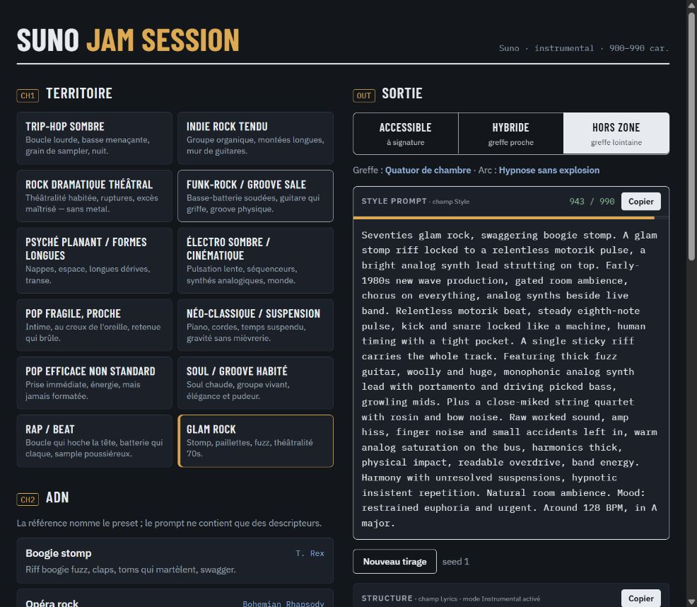

# Suno Jam Session

Un atelier d'exploration musicale pour préparer des **style prompts Suno** : choisir une identité, régler le groove et la matière sonore, explorer trois directions, puis copier le résultat.

**[Ouvrir l'application](https://suno-jam-session.vercel.app/)** · [Analyse critique](docs/ANALYSE.md) · [Backlog priorisé](docs/BACKLOG.md)

L'application sert à explorer des idées en amont de **SONORA**. Elle assemble un vocabulaire musical écrit à la main : aucun modèle d'IA, compte ou crédit n'est nécessaire pour générer le texte. La création et l'écoute des morceaux se font ensuite dans Suno.



## Ce qui fonctionne aujourd'hui

- 12 territoires, chacun avec 4 presets dont une direction « Création » : **48 presets**, plus les bases de territoire.
- 4 greffes proches et 3 lointaines par territoire.
- Trois angles : **Accessible**, **Hybride** et **Hors zone**.
- Réglages de signature, arc, batterie, placement, époque, grain, saturation, espace, racines hard-rock, tempo, tonalité, tension et hypnose.
- Jusqu'à 2 moods et 4 instruments sélectionnés.
- Quatre sorties copiables : Style prompt, Structure pour Lyrics, Exclude styles et Style tags.
- Derniers réglages mémorisés localement ; interface responsive et thème adapté au système.

| Territoires | |
| --- | --- |
| Trip-hop sombre | Indie rock tendu |
| Rock dramatique théâtral | Funk-rock / groove sale |
| Psyché planant / formes longues | Électro sombre / cinématique |
| Pop fragile, proche | Néo-classique / suspension |
| Pop efficace non standard | Soul / groove habité |
| Rap / beat | Glam rock |

## Première session

1. Choisir un **territoire**, puis son **ADN** : un preset ou la base sans détail de référence.
2. Ajuster les réglages. Les sorties se mettent à jour immédiatement.
3. Comparer les trois angles. **Accessible** reprend les réglages ; **Hybride** change la greffe et augmente la tension ; **Hors zone** change la greffe, l'arc, parfois la signature, et augmente certaines intensités.
4. Copier le **Style prompt** dans le champ Style de Suno, la **Structure** dans Lyrics et les **Exclude styles** dans le champ Exclude des options avancées.
5. Activer le **mode Instrumental dans Suno**. La case « Laisser de la place pour une voix » prépare de l'espace pour une future topline SONORA ; elle ne transforme pas la sortie en chanson chantée.
6. Écouter le résultat et noter ce qui fonctionne. **Nouveau tirage** change la seed et les formulations ; ce n'est pas une nouvelle génération audio.

Les références d'artistes ou de morceaux sont des repères dans l'interface. Le moteur construit des descriptions musicales à partir du catalogue.

## Comment le moteur travaille

Territoire → preset → réglages utilisateur → angle et seed → blocs musicaux → ajustement de longueur → Style, Structure, Exclude, Tags et alertes.

À catalogue, réglages, angle et seed identiques, le résultat textuel est reproductible. La seed ne pilote pas Suno. Modifier le catalogue ou le moteur peut changer le texte produit avec la même seed.

Dans la version actuelle, le prompt vise **900–990 caractères**. Le moteur retire certains blocs selon leur priorité quand le texte est trop long, et ajoute des phrases quand il est trop court. Cette règle héritée est une cible interne, pas une preuve de qualité musicale ni une exigence Suno établie. Son évolution est proposée dans le backlog.

Les sliders choisissent des formulations par paliers ; 50 ne signifie pas « 50 % » d'un effet audible. Les indications sous les réglages montrent actuellement une formulation indicative, qui peut différer de la variante tirée ou être retirée pour tenir dans la limite.

## Limites connues

- Usage actuellement **instrumental**. Pas de rédaction de paroles, d'appel à Suno, de génération audio ni d'intégration automatique avec SONORA.
- Pas de bibliothèque de sessions, d'export/import de réglages, d'historique ou de synchronisation entre appareils.
- Les choix peuvent se contredire : « Sans batterie » peut coexister avec une caisse claire décrite dans un preset. Voir les reproductions dans l'analyse.
- Les Style tags résument le territoire, le tempo, la tonalité et les moods ; ils ne reflètent pas toute la greffe ou le preset.
- Les contrôles automatiques vérifient le texte et certaines règles du catalogue. Ils ne valident pas l'interprétation des balises ni l'intérêt musical dans Suno.
- La copie dépend des permissions du navigateur. Le repli actuel sélectionne le texte mais affiche encore « Copié » même en cas d'échec ; correction prévue au backlog.

## Installer et développer

Prérequis : **Node.js 24.x**, npm et Git.

```sh
git clone https://github.com/fbornachot/suno-jam-session.git
cd suno-jam-session
npm ci
npm run dev
```

Ouvrir l'adresse indiquée par Vite, généralement http://localhost:5173.

| Commande | Résultat |
| --- | --- |
| `npm run dev` | Serveur local avec rechargement |
| `npm run typecheck` | Vérification TypeScript |
| `npm test` | 76 tests du moteur et du catalogue |
| `npm run build` | TypeScript puis build dans `dist/` |
| `npm run preview` | Consultation locale du dernier build |
| `npm run audit` | Régénération de `docs/audit-results.json` |

L'audit parcourt 4 500 sorties : 12 territoires × 5 états (4 presets + base) × 25 seeds × 3 angles. Il mesure les blocs retirés, le remplissage et les écarts d'aperçu, puis contrôle 4 500 variantes avec la place pour voix activée. Il contient aussi des exemples ciblés de contradictions. Il ne couvre pas toutes les combinaisons personnalisées.

Sous Windows, si Node signale `UNABLE_TO_VERIFY_LEAF_SIGNATURE` et que le certificat de confiance est déjà installé dans Windows, utiliser les certificats système pour cette session PowerShell :

```powershell
$env:NODE_OPTIONS = '--use-system-ca'
npm ci
```

Ne pas désactiver la vérification TLS.

## Organisation du code

| Chemin | Rôle |
| --- | --- |
| `index.html` | Document, métadonnées et styles |
| `src/ui/main.ts` | Contrôles, rendu, copie et sauvegarde locale |
| `src/engine/types.ts` | Contrats des données et des sorties |
| `src/engine/resolve.ts` | Défauts du territoire et surcharge par preset |
| `src/engine/angles.ts` | Dérivation des trois angles |
| `src/engine/assemble.ts` | Blocs et priorités |
| `src/engine/fit.ts` | Ajustement de longueur |
| `src/engine/structure.ts` | Balises Lyrics |
| `src/engine/lint.ts` | Contrôles textuels |
| `data/territories/` | Territoires, presets, références et greffes |
| `data/lexicon/` | Vocabulaire et règles |
| `tests/engine.spec.ts` | Suite de non-régression |
| `scripts/audit.test.ts` | Protocole d'analyse reproductible |
| `docs/` | Analyse, mesures et backlog |

Pour enrichir un territoire, modifier son JSON, vérifier les identifiants utilisés dans le lexique, puis lancer tests, build et audit. Lors d'un ajout de territoire ou de preset, adapter aussi les assertions de cardinalité et le protocole d'audit. Les comparaisons audio restent manuelles.

## Hébergement Vercel

- Production : **https://suno-jam-session.vercel.app/**
- Projet : `suno-jam-session`.
- Framework : Vite ; installation : `npm ci` ; build : `npm run build` ; sortie : `dist`.
- Aucune variable d'environnement, base de données ou clé API.
- Le build contient un fichier HTML avec le JavaScript intégré. Les polices Google Fonts restent externes, avec des polices système de remplacement.

La première production a été déployée directement depuis les sources locales. **Publier ce dépôt ne configure pas à lui seul le déploiement automatique.** Pour l'activer, connecter ce dépôt au projet Vercel existant dans **Settings → Git**, sélectionner `main` pour la production et vérifier le premier déploiement. Ne pas créer un second projet Vercel.

Le dossier `.vercel/` est local et ignoré par Git. `build-artifact.mjs` est un export facultatif de fragment HTML hérité ; il ne participe pas au déploiement Vercel.

## Données et provenance

Les réglages sont stockés sous la clé locale historique `session-rack:v1`, conservée pour compatibilité. Effacer les données du site supprime cette mémoire. L'application n'intègre pas d'analytics ; l'hébergement et le chargement des polices effectuent leurs requêtes habituelles.

Base : archive **Session Rack v2**, fournie par le propriétaire, rapatriée et renommée **Suno Jam Session**. Inspiration fonctionnelle : [Crate Machine — NormaProds](https://normaprods.com/fr/pages/crate-machine). Aucune affiliation officielle avec Suno, SONORA ou NormaProds n'est revendiquée.

Aucune licence de redistribution n'est ajoutée à ce stade ; son choix reste à définir par le propriétaire.

## Suite du projet

L'[analyse critique](docs/ANALYSE.md) sépare les constats vérifiés, les hypothèses musicales à écouter et les préférences à reconfirmer. Le [backlog](docs/BACKLOG.md) traduit ces constats en lots avec priorités, dépendances et critères d'acceptation. Les améliorations proposées n'ont pas encore été implémentées.
